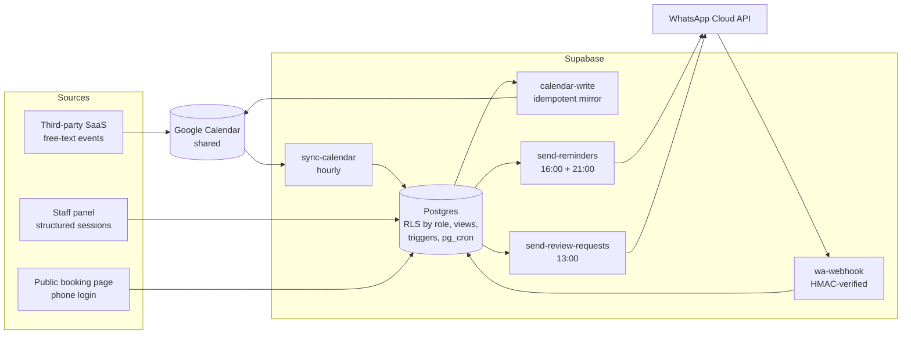
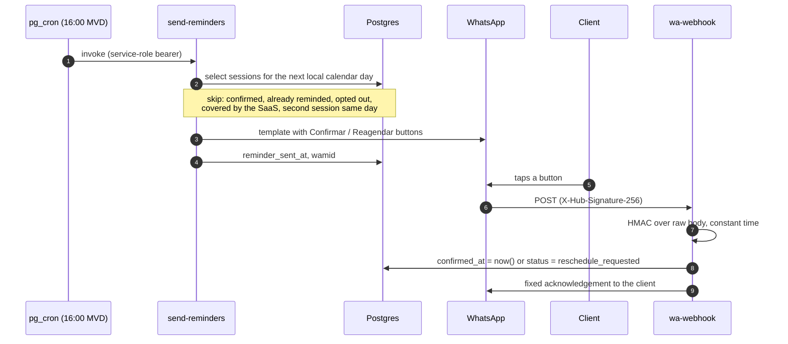

# VAIG — scheduling, reminders and online booking for an aesthetics clinic

Production system for VAIG, an aesthetics clinic in Montevideo, Uruguay. It turns a
shared Google Calendar full of hand-typed events into resolved client identities,
sends WhatsApp reminders with one-tap confirmation, asks loyal clients for Google
reviews, and runs the clinic's own online booking alongside the third-party booking
app the clinic already used.

Built by one engineer in seven weeks (July to September 2026), working with AI
coding agents under an explicit architect / implementer / reviewer process.
In production since day 13.

This repository is a single-commit snapshot of the private production repository
(137 squash-merged PRs), with real identifiers replaced by placeholders.

| | |
|---|---|
| **Stack** | Next.js 14 (App Router) on Vercel · Supabase (Postgres, pg_cron, Deno edge functions) · WhatsApp Cloud API · Google Calendar API |
| **Size** | ~35k lines of TypeScript and SQL · 32 migrations · 5 edge functions · ~800 unit and edge-function tests + 84 integration tests against real Postgres in CI |
| **Users** | Clinic staff (internal panel, mobile-first) and clients (public booking page, phone login) |
| **Source of truth** | [`PRD.md`](PRD.md) (scope contract) and [`docs/`](docs/) (strategy and design docs) |

---

## For reviewers

**My role:** sole engineer. I wrote the PRD, the architecture and the ADRs and reviewed every change; Claude Code agents implemented the code under the process described in [Engineering workflow with AI agents](#engineering-workflow-with-ai-agents).

**If you have 10 minutes, start here:**

| What | Where |
|---|---|
| The core idea: strict identity resolution, no fuzzy matching | [`docs/adr/0001-identity-resolution-strict-cascade.md`](docs/adr/0001-identity-resolution-strict-cascade.md), [`lib/normalize.ts`](lib/normalize.ts) |
| Double booking prevented in the database, not the app | [`supabase/migrations/20260828044934_no_double_booking.sql`](supabase/migrations/20260828044934_no_double_booking.sql) |
| Money under concurrency: locked package credit | [`supabase/migrations/20260831055428_package_credit_integrity.sql`](supabase/migrations/20260831055428_package_credit_integrity.sql) |
| Webhook signature verification (HMAC, constant time, fails closed) | [`supabase/functions/wa-webhook/logic.ts`](supabase/functions/wa-webhook/logic.ts) |
| A test that fails if any staff Server Action skips the auth check | [`lib/auth/staff-actions-guard.test.ts`](lib/auth/staff-actions-guard.test.ts) |
| Availability and slot engine | [`lib/booking/slots.ts`](lib/booking/slots.ts), [`lib/booking/intervals.ts`](lib/booking/intervals.ts) |

---

## Contents

- [For reviewers](#for-reviewers)
- [The problem](#the-problem)
- [System overview](#system-overview)
- [Key flows](#key-flows)
- [Architecture decisions](#architecture-decisions)
- [Data model principles](#data-model-principles)
- [Correctness: time, idempotency, concurrency](#correctness-time-idempotency-concurrency)
- [Security model](#security-model)
- [Testing strategy](#testing-strategy)
- [Engineering workflow with AI agents](#engineering-workflow-with-ai-agents)
- [How the system evolved](#how-the-system-evolved)
- [Repository map](#repository-map)
- [Running it locally](#running-it-locally)
- [Further reading](#further-reading)

---

## The problem

Sessions reached the clinic's calendar from two places: bookings made through a
third-party SaaS (events titled `External - Cita con <name> <phone>`) and events
typed by hand by the staff, often with a nickname, a service abbreviation and no
phone number. A first version of the system (an LLM chatbot, payments, n8n
automations) had collapsed under its own complexity and was frozen.

The reframing that shaped everything after it:

> **The core problem is identity resolution, not automation.** Once every calendar
> event maps to a phone number, reminders and reactivation are trivial.

That sentence bounded the first production version to 3 tables plus a log table,
3 SQL views, 3 edge functions, 1 page and 1 WhatsApp template, plus a written list
of what would **not** be built (chatbot, payments, self-scheduling, fuzzy matching,
multi-tenancy). Every later expansion of scope was declared in writing in the PRD,
naming the rule it overrides.

## System overview



Two session sources coexist on purpose:

- **Legacy path.** Events written by the third-party SaaS or by hand are read by
  `sync-calendar`, classified, and matched to a client through a strict cascade.
- **Structured path.** Sessions created in the staff panel or booked on the public
  page are born structured. The app writes a mirror event to the same shared
  calendar so the team keeps one agenda, tagged with an invisible marker so the
  sync never reads it back as a new session.

All time logic runs in `America/Montevideo`. Every scheduled job writes to
`job_runs`, and the panel shows the last successful run of each job.

## Key flows

### Reminder lifecycle



A session created for tomorrow after the 16:00 batch has already run triggers
its reminder immediately; a 21:00 catch-up run covers sessions that reach the
calendar between the two runs.

### Identity matching cascade (legacy path)

1. **Classify first.** All-day events, staff availability (`Lu no`) and admin
   chores (`pagar BPS`) are discarded before matching. Each run logs a count and
   a sample of what it discarded.
2. **Phone.** The first phone in the title or description that normalizes to a
   valid Uruguayan number and exists in `clients` is a match. Every phone match
   also teaches an alias for free.
3. **Alias.** A client whose alias tokens are a subset of the event tokens, only
   if exactly one client qualifies.
4. **Human queue.** Anything else waits for a person. Resolving one event learns
   an alias and re-matches every queued event it fits, retroactively.

There is no fuzzy matching anywhere: a false positive sends a reminder to the
wrong person, so ambiguity always goes to a human.

### Online booking

Service → professional (or "anyone available") → slot → phone verification by
a WhatsApp code → reservation pending staff confirmation. Availability is
computed from a rules engine (weekly rules, one-off openings, one-off blocks)
minus sessions already booked from **both** sources. When the client picks
"anyone", the professional comes from a per-service priority order. That lets a
highly requested professional sit last in the automatic pool while still being
bookable directly.

## Architecture decisions

The full records (context, alternatives, consequences) live in
[`docs/adr/`](docs/adr/). Summary:

| Decision | Alternatives considered | Why |
|---|---|---|
| **Structured sessions in the app; the calendar becomes a mirror** | Keep improving the free-text parser | Curation cost depended on how each person typed an event; no parser fixes that. Removing free text as the source of truth was the only structural fix. |
| **Coexistence with the third-party app, partitioned by segment** | One big switch for every service at once | Real clients receive WhatsApp daily. A service or professional is offered by exactly one system at a time, so the two never compete for a slot, and each step is reversible. |
| **Strict matching with a human queue** | Fuzzy or ML matching | The cost of a wrong match is paid by a third party. "I don't know" is safer than "probably". |
| **Derived state as SQL views** (`last session`, `next session`) | Stored columns kept in sync | No synchronization code means no synchronization bugs. |
| **Stored, locked balance for prepaid packages** | Count past sessions | Money owed to a client can't be inferred: a count mixes services and dates. |
| **Mirror marker in a private extended property** | Title prefix | A human can edit a title; nobody edits an invisible property by accident. |
| **Deterministic mirror event id** derived from the session id | Store-then-create | Retrying a calendar write can never create a duplicate. |
| **Phone + WhatsApp code as client identity** | Google sign-in, email | The phone is the identity the business already has for every client, and it doubles as the main anti-abuse layer. |
| **No deposit at launch; bank transfer if ever needed** | Payment provider at launch | Ship the cheapest version, measure no-shows per segment, add the heaviest piece only if data asks for it. |
| **Multi-tenant ready, not multi-tenant** | `tenant_id` everywhere now | Services, staff and hours are data, not code. The tenancy tax is paid only when a second customer exists. |
| **First-party, anonymous analytics** | Third-party trackers | Product questions (is this screen used? where do bookings stall?) without cookies or data leaving the project. |

## Data model principles

- **One source of truth per entity, written down.** `clients` owns identity (one
  row per phone, E.164). Sessions are owned by the app for structured sessions
  and by the calendar for legacy ones.
- **Derive what is a query, store what is a commitment.** Views for read models;
  explicit, row-locked counters for anything that represents money.
- **A new meaning gets a new column.** "Pending staff confirmation" for web
  bookings is `pending_confirmation`, not a reuse of `confirmed_at`, which
  already means "the client tapped Confirm".
- **Catalog as data.** Services, durations, professionals, calendar colors and
  booking priority are tables edited from the panel.

## Correctness: time, idempotency, concurrency

**Time.** One timezone, half-open intervals over local calendar days. The
original "24 to 48 hours from now" window, fired at a fixed hour, could never
remind next-morning sessions; windows are now expressed as local days and tested
at 23:59, midnight and the minute after each batch.

**Idempotency.** The sync upserts by calendar event id. Reminders are deduplicated
per client per local day, which also absorbs the same session existing twice in
the calendar. Mirror writes use a deterministic id (`insert`, then `update` on
409). The mirror is best-effort and decoupled: a failed write leaves the session
valid and marked as "mirror pending".

**Concurrency.** Double booking is prevented by a Postgres exclusion constraint,
not by application checks. Package credit is taken under a row lock plus an
advisory lock per client and service. Credit refunds on cancellation live in a
single trigger, because two code paths refunding the same event is how double
refunds happen.

## Security model

| Caller | How it is authenticated | What it can reach |
|---|---|---|
| Staff | Email one-time code + allowlist; rate limited per IP and per email | Panel routes (middleware) and Server Actions that re-check `requireStaff()` before using the service role |
| Client | Phone + WhatsApp code (hashed with a pepper, single use, 10-minute TTL, per-phone and daily caps) | Own `clients` row and own sessions, through RLS on a JWT whose phone claim comes from `app_metadata` (writable only by the service role) |
| Anonymous | none | Public booking catalog and slot times, per-IP rate limited; anonymous funnel events |
| Meta webhook | HMAC-SHA256 over the raw body, constant-time compare, fails closed | Button taps on its own reminders |
| Cron / jobs | Service-role bearer | Edge functions; anon keys cannot trigger sends or calendar writes |

Further measures:

- **Defense in depth.** RLS by role on every table, views with `security_invoker`,
  `SECURITY DEFINER` functions with a fixed `search_path` and execute revoked from
  public.
- **Enforced by a test.** A test classifies every `"use server"` module and fails
  if a staff action can run without a staff session.
- **Response headers.** No framing, `nosniff`, a strict referrer policy and HSTS.
- **Privacy.**
  - Full phone numbers are never logged (last four digits only).
  - Fixtures and tests use invented people.
  - Abandoned bookings are recovered only by a human message, never automatically.
- **Secrets.**
  - A pre-commit hook scans every commit, docs included.
  - The agent's own guardrails block any deploy or secret operation; production
    is a human task.

Known residual risks are tracked, with acceptance criteria, in
[`docs/TECH_DEBT.md`](docs/TECH_DEBT.md).

## Testing strategy

| Layer | Runs | What it proves |
|---|---|---|
| Pure logic (vitest) | Locally, in seconds | Matching cascade, classification, time windows, slot engine, OTP rules, guards |
| Edge functions (Deno test) | Locally | Batch selection, webhook signature and payloads, the HTTP contract with Google |
| Integration (vitest + real Postgres) | CI only, against an ephemeral Supabase stack with every migration applied | RLS per role, views, constraints, triggers, rate limiter, dedup across sources |
| Fixtures | Both | A 30-event calendar replica with the exact shape of real data and invented people |

Development machines run Docker-free: `npm run check` (lint, types, unit and
function tests) is the local verdict, and CI is the referee. Several bugs that
passed every local check were caught only by the integration stage or by review.
Examples: a partial unique index that Postgres cannot use as an `ON CONFLICT`
target, a `CREATE OR REPLACE VIEW` that inserted a column mid-list, and a Google
endpoint that only accepts client-chosen ids on `insert`.

## Engineering workflow with AI agents

The repository is also an experiment in running production-grade work with AI
coding agents on a fixed budget. The rules live in [`CLAUDE.md`](CLAUDE.md) and
[`.claude/`](.claude/):

- **Roles.**
  - An architect session owns spec, plan, review and integration.
  - A cheaper implementer model does mechanical work from exact specs.
  - A read-only adversarial reviewer audits every diff before a PR.
  - Matching, timezone logic, webhook signatures, migrations and anything
    security-sensitive are never delegated.
- **Deterministic guardrails.** A pre-tool hook blocks pushes to `main`, force
  pushes, deploys, secret operations, edits to existing migrations and edits to
  the agent's own configuration, regardless of how a request is phrased.
- **One task, one session, one PR.** Each task is an issue with acceptance
  criteria tied to a PRD section. Out-of-scope findings go to a tech debt log
  instead of growing the PR.
- **Result.** In three consecutive tasks, adversarial review caught a
  production-breaking bug that had passed lint, type checks and tests. All three
  sat at the boundary with an external system (Postgres semantics, a Google API
  contract, a midnight timing race), where tests written from the same mental
  model cannot see.

## How the system evolved

| Date | Milestone |
|---|---|
| before Jul 2026 | v1 (LLM bot, payments, n8n) frozen: too much surface for a three-person business |
| 13 Jul | v2 PRD: identity resolution, written non-goals, minimal surface |
| 26 Jul | Reminders live for real clients after an end-to-end rehearsal on owner phones (`dry_run`, test-phone override) |
| 7–8 Aug | v3: structured sessions + calendar mirror, shipped in six PRs without a cutover |
| 16 Aug | Automated Google review requests (loyalty-based, no review gating) |
| Aug | Consolidation pass: one service-role client, one client-creation path, one design token set |
| 26–31 Aug | Online booking: RLS by role first, availability engine, phone login, public page, prepaid packages, rate limiting |
| 2 Sep | First-party analytics: booking funnel, recovery queue, panel usage |

**What I would do differently from day one:** role-based RLS in the first
migration, a single date/timezone module and design-token file before the first
screen, first-party analytics from the start, and individual staff logins
(shared accounts make per-person attribution impossible).

## Repository map

```
app/
  (app)/            staff panel: agenda, unmatched queue, clients, packages, hours, metrics
  (public)/reservar public booking page
  api/              client auth, booking, analytics intake
lib/                domain logic, framework-free where possible
  normalize.ts      phone/text normalization, tokenization (the identity core)
  booking/          availability rules, slots, priority, reservation
  client-auth/      phone OTP flow (pure decisions + I/O ports)
  security/         Postgres-backed rate limiter
  auth/             staff login, requireStaff, server-action guard test
supabase/
  migrations/       schema, RLS, views, triggers, cron (never edited after merge)
  functions/        sync-calendar, calendar-write, send-reminders,
                    send-review-requests, wa-webhook (+ _shared)
tests/integration/  CI-only tests against real Postgres
fixtures/           anonymized calendar replica
docs/               ADRs, architecture, domain glossary, strategy, deploy, operations, tech debt
```

## Running it locally

Requirements: Node 20+. `deno` and the Supabase CLI come as dev dependencies.

```bash
npm ci                    # also installs the pre-commit secret scanner
cp .env.example .env      # fill only what the task at hand needs
npm run dev
npm run check             # lint + typecheck + unit + edge-function tests
```

There is no local database. Migrations are authored with
`npx supabase migration new <name>` and validated in CI, which starts an
ephemeral Supabase stack and runs `npm run test:integration`.

| Script | Purpose |
|---|---|
| `npm run dev` / `build` | Next.js dev server / production build |
| `npm run check` | The local verdict, Docker-free |
| `npm run test:integration` | CI only, needs the Supabase stack |
| `npm run scan-secrets` | Scan the whole tree for secrets |

## Further reading

- [`docs/adr/`](docs/adr/): 16 architecture decision records.
- [`docs/architecture/frontend.md`](docs/architecture/frontend.md): rendering
  model, data flow, booking flow, mobile-first details, design tokens, and what
  would change at a larger scale.
- [`docs/knowledge-base/domain/terminology.md`](docs/knowledge-base/domain/terminology.md):
  Spanish domain terms mapped to code and database names.
- [`PRD.md`](PRD.md): the scope contract, including the explicit overrides for
  v3 and review requests.
- [`docs/booking-analytics.md`](docs/booking-analytics.md): privacy-first
  instrumentation design.
- [`docs/operations.md`](docs/operations.md): scheduled jobs and the staff
  operating manual.
- [`docs/deploy.md`](docs/deploy.md): deployment runbook (human-only steps).
- [`docs/TECH_DEBT.md`](docs/TECH_DEBT.md): known issues with priorities and
  acceptance criteria.
